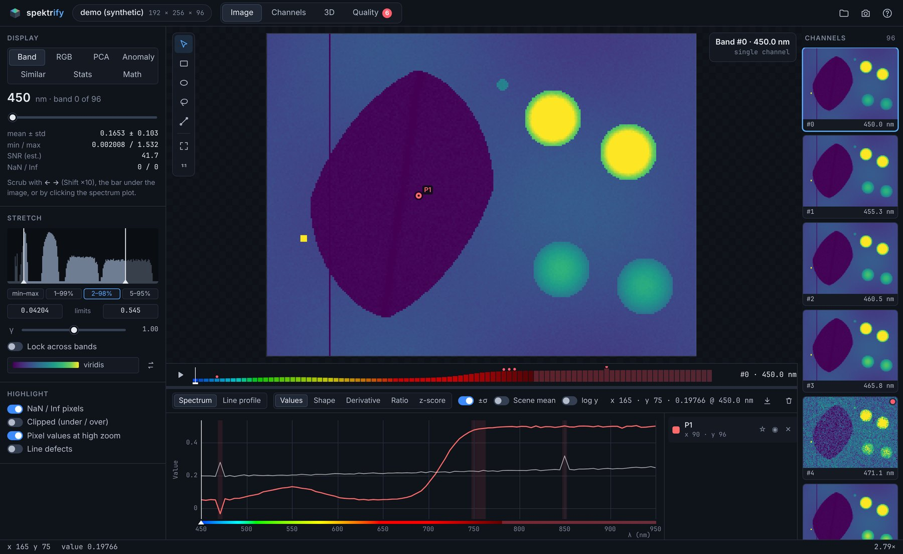
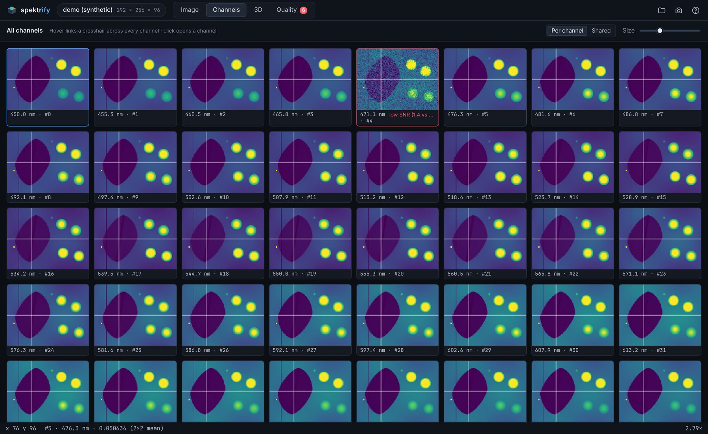
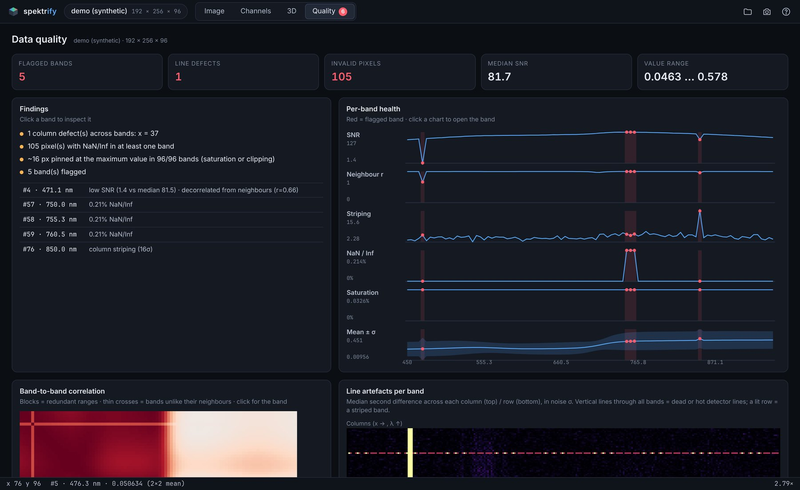
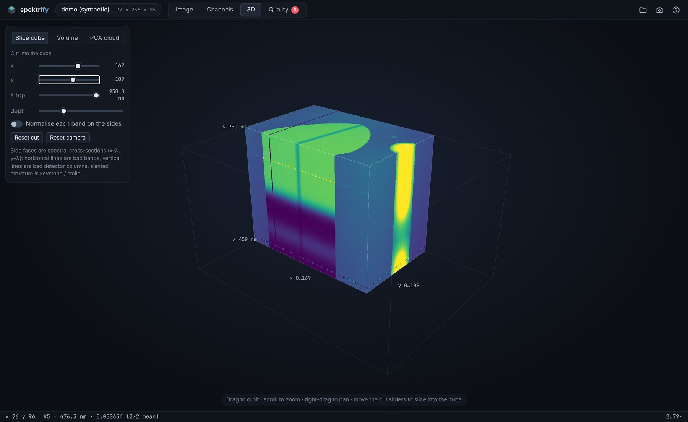
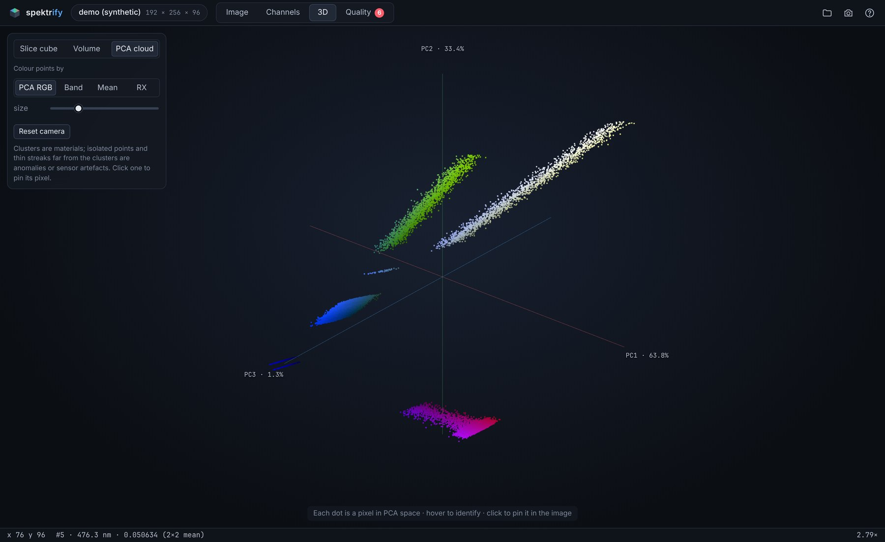

# spektrify

A fast, friendly viewer for multispectral and hyperspectral cubes. It runs in your browser
from a local Python process. Scrub through channels, compare spectra, look at the cube in 3D,
and find sensor artefacts and anomalies without writing plotting code.



## Install and run

```bash
pip install "spektrify[all] @ git+https://github.com/kalfasyan/spektrify"

spektrify cube.h5          # or .npy .npz .mat .tif, or ENVI .hdr + data
spektrify --demo           # a synthetic scene with planted artefacts
spektrify                  # opens the file browser; you can also drag & drop a file
```

The UI comes prebuilt inside the package, so you don't need Node. The only hard dependency is
NumPy. The extras add more readers: `hdf5` (h5py), `mat` (scipy), `tiff` (tifffile), or `all`.

To use it on a remote GPU box, run `spektrify cube.h5 --no-browser` there, then
`ssh -L 8765:localhost:8765 box` and open http://localhost:8765.

From Python or Jupyter:

```python
from spektrify import show

v = show(cube, wavelengths=wl)   # (H, W, C) or (C, H, W); layout is guessed or pass layout="hwc"
v.update(denoised)               # the open tab switches to the new array
show(cube, inline=True)          # embed in the notebook
```

## What you can do

| View | For |
| --- | --- |
| **Image** | Band, false-colour RGB, PCA, anomaly (RX, PCA residual, spectral roughness), spectral similarity (SAM), per-pixel stats and band math (`(nm(800) - nm(670)) / (nm(800) + nm(670))`). Histogram stretch with presets, gamma, and highlights for clipped, NaN and defect pixels. |
| **Spectra** | Hover any pixel; click to pin it, or draw rectangles, ellipses and freehand regions (mean ± σ). Views: values, shape, derivative, ratio to a reference, z-score against the scene. CSV export. |
| **Line profile** | Drag a line to see the spectral cross-section along it. |
| **Channels** | Every band as a tile with a crosshair linked across all of them. Misregistration, striping and noisy bands stand out. |
| **3D** | Slice cube with cut planes (the x–λ and y–λ faces show keystone, smile and bad columns), GPU volume rendering (MIP or composite), and pixels as a PCA point cloud. Click a point to pin its pixel. |
| **Quality** | Automatic checks for low SNR, decorrelated bands, column and row striping, dead or hot lines, NaN/Inf and saturation. Every chart links back to the band it is about. |

Press `?` in the app for all keyboard shortcuts. The most used ones: `← →` change band,
`Space` plays through the bands, and `B C P N S M` switch display modes.

| | |
| --- | --- |
|  |  |
|  |  |

## Architecture

The project is built so any layer can be replaced without touching the others. The main ones:

- **Readers** (`spektrify/io`): each file format is one small module registered by suffix.
- **Compute backend** (`spektrify/compute`): an `Analyzer` protocol with a NumPy reference
  implementation. A Rust/PyO3 or GPU version only has to register itself.
- **API** (`spektrify/server/routes.py`): transport-free handlers. The stdlib HTTP adapter is
  a thin shell around them.
- **UI** (`frontend/`): Svelte for panels and state. The WebGL image renderer and the three.js
  3D engine are framework-free modules.

[docs/architecture.md](docs/architecture.md) covers the module boundaries, the API contract,
how to add a reader or backend, and how to rebuild the UI.

## Development

```bash
pip install -e ".[dev]"
pytest
ruff check src tests

# UI (only if you change frontend/)
cd frontend && npm install
spektrify --demo --no-browser &   # API on :8765
npm run dev                       # hot-reloading UI on :5173, proxies /api
npm run build                     # writes src/spektrify/static (commit the result)
```

## License

GPL-3.0. Bundles [three.js](https://threejs.org) (MIT).
